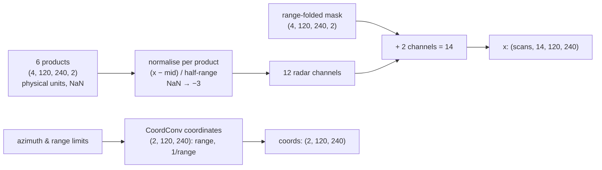

# The data

TorNet v1.1 (MIT Lincoln Laboratory; Veillette et al., AIES 2024; CC BY 4.0), repackaged on the
Hugging Face Hub as **`jakeryderv/tornet`**: every sample, every field, as Parquet.

## What a sample is

One storm, four NEXRAD WSR-88D scans about five minutes apart, on a polar grid centred on the
storm: 120 azimuths × 240 range gates (250 m) × 2 elevation tilts (0.5°, 0.9°).

| field | shape / type | meaning |
|---|---|---|
| `DBZ` | (4, 120, 240, 2) float16 | reflectivity, dBZ |
| `VEL` | (4, 120, 240, 2) float16 | radial velocity, m/s |
| `KDP` | (4, 120, 240, 2) float16 | specific differential phase, °/km |
| `RHOHV` | (4, 120, 240, 2) float16 | correlation coefficient |
| `ZDR` | (4, 120, 240, 2) float16 | differential reflectivity, dB |
| `WIDTH` | (4, 120, 240, 2) float16 | spectrum width, m/s |
| `range_folded_mask` | (4, 120, 240, 2) uint8 | 1 where `VEL` / `WIDTH` are range-folded |
| `frame_labels` | int8[4] | tornado present in each scan |
| `time` | int64[4] | each scan's time, Unix seconds |
| `category` | string | `TOR` confirmed, `WRN` warned but none, `NUL` random storm |
| `ef_number` | int8 | EF rating for `TOR`, −1 otherwise |
| `az_lower`, `az_upper`, `rng_lower`, `rng_upper` | float32 | the chip's azimuth (°) and range (m) limits |
| `tornado_start_time`, `tornado_end_time` | int64 | the tornado's interval, 0 when none |
| `event_id`, `episode_id`, `site`, `lat`, `lon`, `filename`, `partition`, `year`, `label` | | metadata |

Empty gates are NaN. Values are physical units; nothing is normalised in the files.

## How much

| year | train | test | | year | train | test |
|---|---|---|---|---|---|---|
| 2013 | 3,498 | 573 | | 2018 | 15,360 | 2,518 |
| 2014 | 17,447 | 2,546 | | 2019 | 20,588 | 4,031 |
| 2015 | 19,721 | 3,902 | | 2020 | 18,147 | 4,756 |
| 2016 | 18,791 | 2,951 | | 2021 | 19,051 | 4,268 |
| 2017 | 16,927 | 3,145 | | 2022 | 22,136 | 2,777 |

203,133 samples: 171,666 train, 31,467 test; 13,857 `TOR`, 64,510 `WRN`, 124,766 `NUL`.
Pre-onset tornado cases are far fewer: about 200 to 275 per test year.

## Layout on the Hub

```
data/train/<year>/part-NNNNN-of-MMMMM.parquet    256 samples per shard, zstd, ~170 MB
data/test/<year>/part-NNNNN-of-MMMMM.parquet
metadata/<partition>-<year>.parquet              the scalar fields, one row per sample
catalog.parquet                                  all metadata merged
```

A year is a config (`load_dataset("jakeryderv/tornet", "2015")`), the `catalog` config is the
metadata alone, and any subset is a `data_files` pattern. This repo reads the shards directly.

## From a row to the model's tensors



The normalisation is the published detector's, so its weights apply unchanged:

| product | range used | | product | range used |
|---|---|---|---|---|
| DBZ | −20 … 60 | | RHOHV | 0.2 … 1.04 |
| VEL | −60 … 60 | | ZDR | −1 … 8 |
| KDP | −2 … 5 | | WIDTH | 0 … 9 |

The two oldest scans become the input `x`; the two newest are the targets. Each item also
carries the per-scan labels, the real lead in minutes of each target from the last input, the
spacing of the inputs, and the authors' sample weight (EF2+ ×2, warned storms ×0.5).

## Loading

`shard_paths` fetches the shards of the configured years into the Hub file cache once (2015 is
about 12 GB). `OnsetDataset` streams them with pyarrow one shard at a time: shard order is
reshuffled every epoch and rows within a shard are shuffled; DataLoader workers take disjoint
shards. A shard decodes to about 0.8 GB, so memory is one shard per worker and no uncompressed
copy of the dataset is ever written.

**Validation** is held out from the training partition by whole days (15% of days), never by
random sample: consecutive samples of one storm are near-duplicates and would leak.
