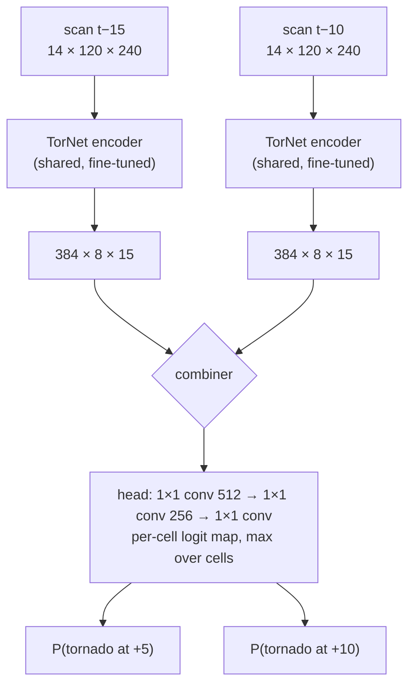
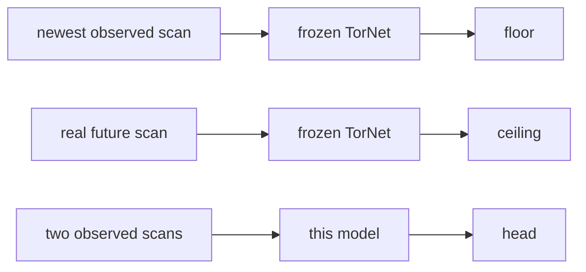

# The model

The published TorNet detector, fine-tuned on the onset target, with the authors' head on top.
Weights come from **`jakeryderv/tornet-detector-torch`** (the official Keras checkpoint converted
once to a torch state dict, verified to 2e-5 in the logits).

## Architecture

### Encoder: the TorNet CNN

| block | layers | filters | output |
|---|---|---|---|
| 1 | 2 × CoordConv 3×3 | 48 | 48 × 120 × 240 |
| 2 | 2 × CoordConv 3×3 | 96 | 96 × 60 × 120 |
| 3 | 3 × CoordConv 3×3 | 192 | 192 × 30 × 60 |
| 4 | 3 × CoordConv 3×3 | 384 | 384 × 15 × 30 |
| pool | 2×2 max, ceil | | **384 × 8 × 15** |

A CoordConv layer concatenates the two coordinate channels (range, 1/range, pooled alongside
the features) before a 3×3 convolution with ReLU. Each block ends with 2×2 max pooling and
dropout 0.1. Initialised from the published weights and trained at a tenth of the head's
learning rate.

### Combiner: how two scans become one map

| `combiner` | what the head sees | head |
|---|---|---|
| `concat` (default) | the two maps side by side: 768 × 8 × 15 | fresh, 2 output maps |
| `extrapolate` | per horizon, f(+h) = f_new + (lead_h / Δt) · (f_new − f_old), using the real scan times | one shared 384-channel head, optionally the published head's weights |

With two scans a feature's history is a line; `concat` lets the head learn any combination of
value and slope, `extrapolate` fixes the slope rule and the clock. Same expressive power,
different inductive bias.

### Head: the authors' design

1×1 convolutions 512 and 256 with ReLU, a 1×1 convolution to one logit per cell, then the
maximum over the 8 × 15 cells. The map before the max is the paper's spatial likelihood map,
saved per sample at scoring time.

4.9M parameters in total.

## Training

| | |
|---|---|
| loss | weighted binary cross-entropy on each horizon's logit; sample weights EF2+ ×2, warned ×0.5 |
| optional | `consistency_weight`: L1 between f(+h) and the encoder's features of the real scan at +h (detached), `extrapolate` only |
| optimiser | AdamW, lr 1e-4 (head) and 1e-5 (encoder), weight decay 1e-4, grad clip 1.0 |
| schedule | cosine over the epoch cap (8) |
| precision | mixed (bf16/fp16 autocast on CUDA) |
| batch | 16 |
| early stopping | on the mean validation head AUC, patience 2; the best checkpoint is scored |

## Evaluation: the judge

The frozen published detector reads two chips per sample and horizon:

Per horizon, `summary.json` holds AUC/AUCPR per view (NC, RC, WC) for all samples and for the
pre-onset subset, paired bootstraps of head and ceiling against the floor, and the best-CSI
threshold. Every run also writes per-sample prediction CSVs with the label pattern and
pre-onset flags, the 8 × 15 likelihood maps, and `features.npz` (head logits plus max- and
mean-pooled bottleneck features) for downstream models.

## Configs

| config | varies |
|---|---|
| `y2015` | the model above on 2015 |
| `y2015_extrapolate` | `combiner: extrapolate`, head from the published weights |
| `y2015_extrapolate_consistency` | plus the consistency loss |
| `smoke_2015` | `y2015` on 6,000 samples |

Any key of `tornado_onset.config.Config` can be set in a config file or with
`--set key=value`; `onset-summary` tabulates finished runs against floor and ceiling.

## What was tried and dropped

A U-Net decoder drawing the future velocity and reflectivity, trained by a heat-map-weighted
L1 and the judge's cross-entropy on the drawn chip, as an auxiliary signal for the encoder. On
2015 the head-only model matched or beat it with half the parameters, so it went.
