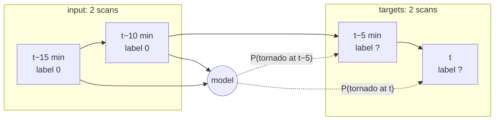
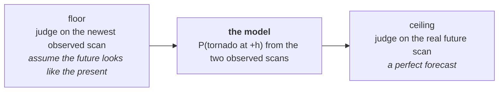

# The problem

**Given the radar scans observed so far, will a tornado appear in the next 5 and 10 minutes
when none is visible yet?**

This is a prediction task framed so that it cannot be solved by detection. A tornado that is
already on the radar is easy to carry forward; the useful question is the one before that.

## The target, scan by scan

A TorNet sample is four scans of one storm, about five minutes apart, each with its own tornado
label. The model sees the two oldest scans and answers for each of the two newest.

Each sample's four labels read as a pattern. Only some patterns are the question:

| pattern | meaning | role in evaluation |
|---|---|---|
| `0001`, `0011` | no tornado in the inputs, one in the last target | **pre-onset case**: the positives |
| `0111`, `1111`, `01xx` … | a tornado already visible in an input scan | *ongoing*: excluded from the positives |
| `0000` | no tornado | negatives (every null sample is kept) |

The positives are restricted to pre-onset cases so the score answers "will one appear", not
"will one persist".

## How a prediction is scored

Every test sample gets a probability per horizon. Three views of the negatives, following the
TorNet paper:

| view | negatives | what it measures |
|---|---|---|
| NC | all nulls | overall skill |
| RC | random non-tornadic storms | tornado vs ordinary storm |
| **WC** | tornado-**warned** storms with no tornado | **the hard case, the headline number** |

The metric is AUC (and AUCPR) with bootstrap intervals, plus the best-CSI threshold.

### Floor and ceiling

The published TorNet detector, frozen, provides two reference points on the same samples:

A result is the model's AUC against the floor, as a **paired bootstrap difference on the same
files** with a 95% interval. The gap between floor and ceiling is the whole prize for
forecasting radar: on one year it is about 0.05 to 0.07 WC AUC.

## Power

Pre-onset positives are rare by construction: roughly 200 to 275 per test year. Every
pre-onset number therefore carries an interval of about ±0.025 AUC, and differences under
about 0.03 are not resolvable on one year. Two consequences:

- Every comparison is paired, on the same files, with its interval stated.
- More seeds and more years are the only way to shrink the noise; no architecture change can.

## Scope

In: the two-scan, two-horizon framing above; the authors' train/test partitions; validation
held out by whole days; the published detector as starting point and judge.

Out, for now: longer scan histories, environmental fields, operational thresholds and lead-time
products. They become questions once the radar-only number is pinned down.
