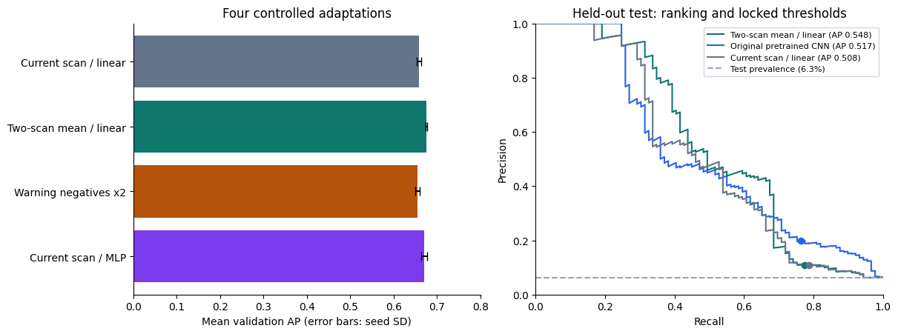
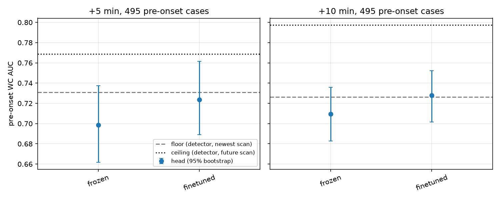

## The problem

- TorNet is a tornado **detection** benchmark: radar chips of a storm, labeled for whether a tornado is in them, and a published CNN that answers that from one scan
- Detection isn't what's missing in the last minutes before a touchdown. A signal *before* the signature is obvious would be
- So the question is **prediction**: given the two oldest of a sample's four scans, how likely is a tornado in each of the two newest, about +5 and +10 minutes out?

## Keeping it honest: what gets scored

- A tornado already on the radar is trivial to carry forward
- So we score only **pre-onset** cases: nothing tornadic in the input scans, a tornado in the last target scan
- Negatives are the hard ones: storms under a tornado **warning** that never produced one

## Keeping it honest: floor and ceiling

- Both come from the published detector itself, frozen, as released
- **Floor**: the detector on the newest observed scan. What a forecaster already has
- **Ceiling**: the detector on the real future scan. What detection gives if the radar forecast were perfect
- A model lands somewhere between. The result is its paired difference from the floor on the same test files, with a 95% interval

## The data

- TorNet v1.1: 203,133 samples, 2013 to 2022. Four NEXRAD dual-pol scans per sample about five minutes apart, six products at two tilts, a label per scan
- Repackaged on the Hugging Face Hub as Parquet by year, detector weights alongside: nothing to download by hand
- This round is **2014 and 2015**, cut two ways
  - detection steps: 6,414 clips split by storm group, 1,422 test with 89 positives
  - onset steps: the authors' partitions, 37,168 train, 6,448 test with 495 pre-onset cases

## Model A: frozen features, small head

- The published CNN, frozen: four CoordConv blocks ending in a 384-channel map over an 8 × 15 grid
- Each scan reduced to its 384 pooled features, scaled, read by a 385-parameter linear head
- Target: tornado presence in the **current** scan
- With two scans, the current and the one five minutes earlier, the feature vectors are averaged
- Three seeds, validation picks the epoch and threshold, test touched once

## Model B: two scans, the authors' head, onset target

- The same CNN run on both input scans, the two maps concatenated cell by cell into 768 channels
- On top, a fresh copy of the authors' own head: 1×1 convs to a per-cell logit, max over cells
- One logit per horizon, weighted cross-entropy against the **future** scans' labels
- CNN frozen in one run, fine-tuned at a tenth of the head's learning rate in the other
- Early stopping on validation AUC, cap of five epochs

## The ladder: five steps, one change each

| step | what changes | question |
|:--:|:--|:--|
| 0 | nothing trained: the published detector, one scan | what does it already give? |
| 1 | new linear head on frozen features, current scan | can a retrained head beat the detector at its own job? |
| 2 | the scan five minutes earlier added, features averaged | does a second scan carry anything the first doesn't? |
| 3 | frozen CNN, both scans, the authors' head retrained on +5 / +10 labels | can the features be re-aimed at "will it appear"? |
| 4 | the CNN unfrozen | does adapting the features buy more? |

## Steps 1 and 2: the detection task

| configuration | validation AP | test AP | at the locked threshold |
|:--|:--:|:--:|:--|
| original pretrained CNN | | 0.517 | 68 of 89 found, 276 false alarms |
| step 1: current scan, linear head | 0.658 | 0.508 | 70 found, 571 false alarms |
| step 2: two-scan mean, linear head | **0.675** | **0.548** | 69 found, 564 false alarms |
| current scan, MLP head | 0.670 | | not selected |
| warned negatives ×2 | 0.656 | | not selected |

## Steps 1 and 2: what they say

- **Step 1: no.** A new head on the frozen features doesn't beat the detector's own, and neither more head capacity nor reweighting the hard negatives changes that
- The detector's readout of its features is about as good as those features get: anything more needs new information, not a better readout
- **Step 2: yes, with a caveat.** The second scan was the only change that moved validation, and it carried to test
- But false alarms doubled at the same recall, and the paired interval on the gain, [−0.06, +0.16], includes zero
- What it establishes: the second scan carries signal the first doesn't

## Steps 1 and 2: the picture

## Step 0: the stakes

| pre-onset AUC vs warned storms, 2014–2015 | +5 min | +10 min |
|:--|:--:|:--:|
| floor: detector on the newest scan | 0.731 | 0.726 |
| ceiling: detector on the future scan | 0.769 | 0.797 |
| ceiling minus floor, paired | +0.038 [+0.016, +0.063] | +0.071 [+0.048, +0.093] |

## Step 0: what it says

- The detector carried forward already scores 0.73 on 495 pre-onset cases: the signature is often half-formed five minutes before the label flips
- The gap to the ceiling is the entire prize for forecasting the radar: 0.04 at +5, 0.07 at +10
- Even a perfect picture of the next scan, read by this detector, adds that much and no more. Anything steps 3 and 4 gain has to fit inside it

## Steps 3 and 4: the onset task

| pre-onset AUC vs warned storms | +5 min | paired vs floor | +10 min | paired vs floor |
|:--|:--:|:--:|:--:|:--:|
| floor | 0.731 | | 0.726 | |
| 3: frozen CNN, two scans, new head | 0.699 | −0.032 [−0.045, −0.020] | 0.710 | −0.017 [−0.024, −0.010] |
| 4: fine-tuned | 0.724 | −0.007 [−0.031, +0.015] | 0.728 | +0.001 [−0.016, +0.018] |
| ceiling | 0.769 | | 0.797 | |

## Steps 3 and 4: what they say

- **Step 3 lands below the floor**, and not by noise. Step 1's answer again on the harder task: a new head on frozen features doesn't match the published head carried forward
- **Step 4 recovers the floor and no more.** Fine-tuning lifts the head by about 0.02 to a tie with the detector at both horizons
- Validation was still rising at the epoch cap, so a longer fine-tune might take a little more. The ceiling bounds how much
- Same picture in each year: ties the floor in 2015, trails it in 2014

## Steps 3 and 4: the picture

## The takeaway

- A detector can be pointed at the ten minutes before a tornado, and what it finds there is what it already finds in the latest scan
- Its features carry a real early signal, which is why the floor sits at 0.73
- Re-reading or fine-tuning them over two scans adds nothing to it, and even a perfect next scan would add only a few hundredths

## What's next: cheap

- The full dataset. Ten years is a config change
- It fixes the two things that limited this round: a fine-tune still improving at the cap, and test intervals wide enough to hide a gain of a couple of hundredths

## What's next: larger

- Use the detector for detecting, and build what's missing around it
- **Longer storm histories** than two scans, so a temporal model learns how a storm has been evolving rather than one difference
- **A forecasting model** that learns those patterns and does two jobs: hands the detector the context one scan leaves out, and predicts the radar itself, so the detector reads a forecast scan
- The ceiling is exactly that model with perfect predictions, and the first number in this project that clears the floor
